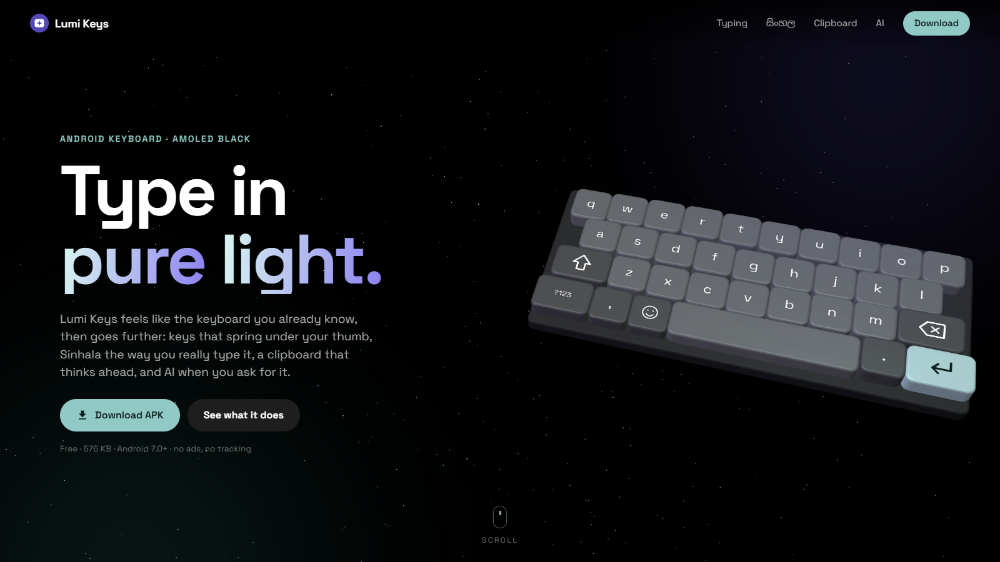
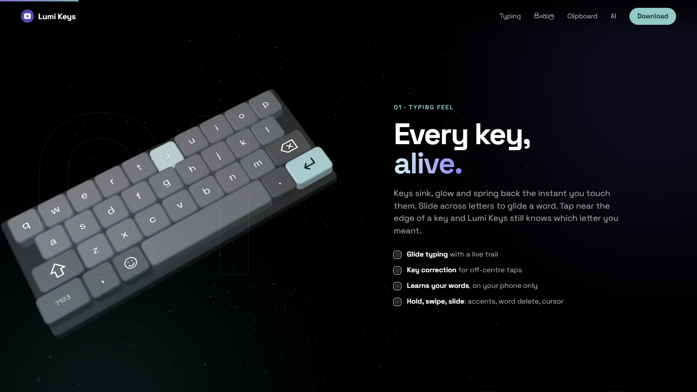
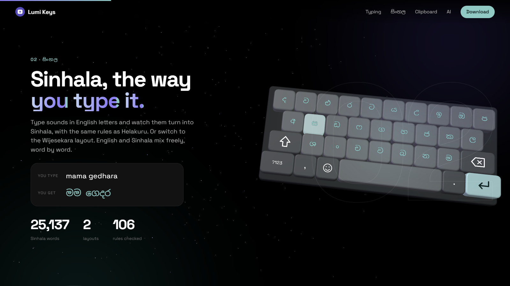
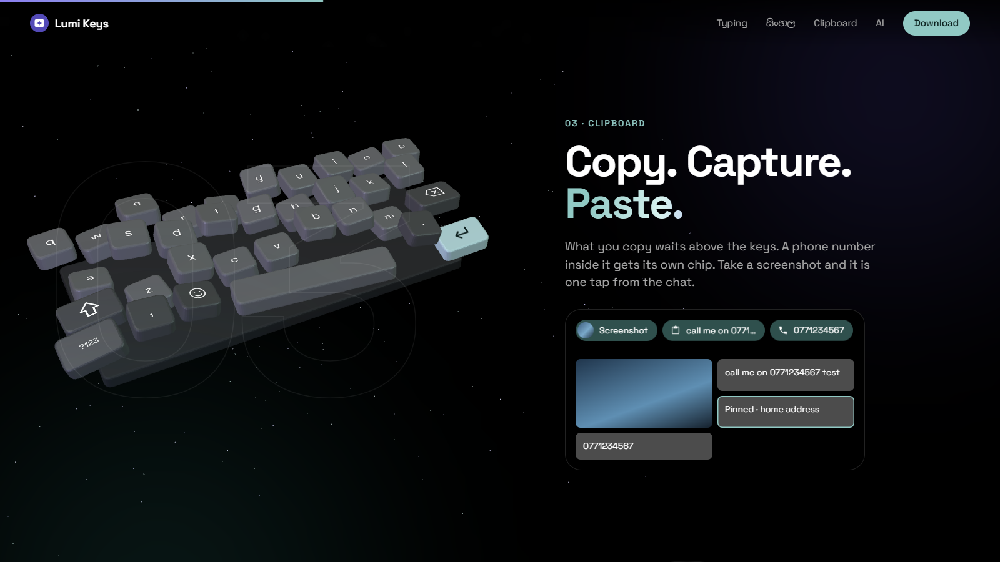
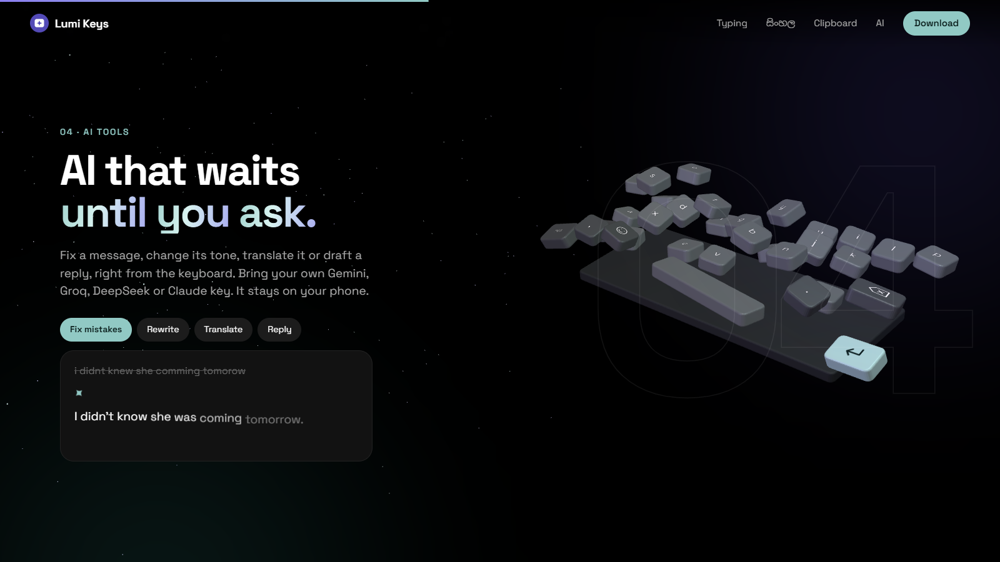

  

  # Lumi Keys

  ### Android Keyboard — AMOLED Black

  **Type in pure light. Your keyboard, your language, your AI.**  
  *Gboard-style typing • Sinhala & Singlish • Smart clipboard & screenshots • AI with your own key • 100% on-device learning.*

   

  

    
    &nbsp;
    
  

  

    
    &nbsp;
    
    &nbsp;
    
    &nbsp;
    
  

  

    
  

   

  

 

---

## 🎯 Overview

Most keyboards either look great or know your language, and the smart ones send what you type to the cloud.

**Lumi Keys** is built to feel exactly like the keyboard you already know, then go further:

- ⌨️ **Gboard-grade typing:** keys that sink, glow and spring back under your thumb, glide typing, predictions and optional autocorrect.
- 🇱🇰 **Sinhala the way you type it:** Singlish with Helakuru's rules (`kohomadha` → කොහොමද) or the Wijesekara layout, with 25,000+ Sinhala words and automatic English / Sinhala per word.
- 📋 **A clipboard that thinks ahead:** what you copy and your newest screenshot wait above the keys, ready to paste.
- ✨ **AI only when you ask:** fix, rewrite, translate or reply right from the keyboard, with your own Gemini, Groq, DeepSeek or Claude key.
- 🔒 **Private by default:** learns your words on the phone only, never in password boxes, no ads, no trackers.

---

## 📸 Visual Tour & Features

<table>
<tr>
<td width="50%" align="center">

 <b>⌨️ Every key, alive</b> 
Keys sink, glow and spring back. Glide typing, key correction for off-centre taps, and on-device learning.
</td>
<td width="50%" align="center">

 <b>🇱🇰 Sinhala, the way you type it</b> 
Singlish with Helakuru's rules or Wijesekara. English and Sinhala mix freely, word by word.
</td>
</tr>
<tr>
<td width="50%" align="center">

 <b>📋 Copy. Capture. Paste.</b> 
Copied text, phone numbers and screenshots as chips above the keys, plus a clipboard with Recent and Pinned.
</td>
<td width="50%" align="center">

 <b>✨ AI that waits until you ask</b> 
Fix mistakes, rewrite the tone, translate (Sinhala ⇄ English) or draft a reply, with your own key.
</td>
</tr>
</table>

---

## ⚡ Everything Inside

| | |
|---|---|
| ⌨️ **Typing** | Glide typing with trail · predictions · optional autocorrect (undo with Delete) · key correction · hold for accents and numbers · swipe Delete for words · slide space to move the cursor |
| 🇱🇰 **Sinhala** | Singlish (Helakuru rules) · Wijesekara layout · 25,000+ word suggestions · EN / සිං key |
| 📋 **Clipboard** | Copy and screenshot chips · phone numbers, emails and links pulled out · Undo chip · Recent and Pinned (kept 1 hour, pins forever) |
| 😀 **Emoji** | Smart search (everyday words, Singlish, typos) · emoji suggestions while typing · recents |
| ✂️ **Editing** | Text editing panel: arrows, Select, line start/end, Select all, Cut, Copy, Paste |
| ✨ **AI** | Reply · Rewrite · Fix mistakes · Translate · Meaning · Ask AI · Memory — Gemini, Groq, DeepSeek or Claude, your key |
| 🎨 **Look** | AMOLED, Dark, Light and Violet themes · keyboard height · number row · key pop-up · vibration strength |
| 🔒 **Privacy** | Learning stays on the phone · nothing learned in password or private boxes · one button clears it all |

---

## 📥 Install

1. Download **`LumiKeys-1.1.apk`** from the [latest release](https://github.com/damsarachethiyaa-dev/lumi-keys/releases/latest).
2. Open it on your phone and allow installing from your browser or file manager.
3. Open **Lumi Keys** → **Setup**: turn it on, then switch to it.

> Requires Android 7.0 or later. Free, 576 KB, no ads, no account.

---

This repository holds the website and the app downloads only. 
English word list: FrequencyWords by Hermit Dave · Sinhala word counts: Sinhala Wikipedia · CC BY-SA 4.0

